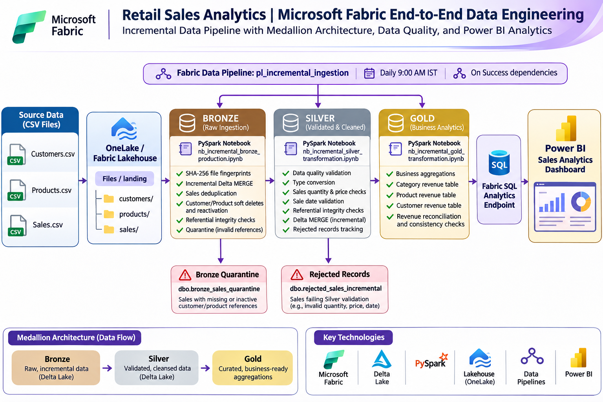
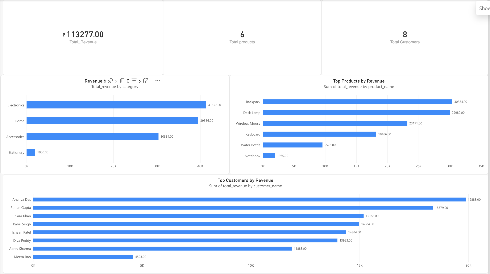

# Retail Sales Analytics | Microsoft Fabric End-to-End Data Engineering

### End-to-End Incremental Data Engineering Project Using Microsoft Fabric, PySpark, Delta Lake, Medallion Architecture & Power BI

## Project Overview

## Live Microsoft Fabric Project

Explore the actual implementation deployed in Microsoft Fabric.

| Component | Live Access | Source Artifacts |
|---|---|---|
| Power BI Dashboard | [View Dashboard](https://app.fabric.microsoft.com/groups/fb0d648b-8518-4023-8545-1c4f4e90d4aa/reports/ff2ad2cb-e0e4-4ba4-ab23-47b6a420467f/c34c2223ff808de3dab2) | [Power BI Report](./powerbi/) |
| Data Pipeline | [View Pipeline](https://app.fabric.microsoft.com/groups/fb0d648b-8518-4023-8545-1c4f4e90d4aa/pipelines/ec1213d7-fec6-425b-8dfc-618a3383f5b8) | [Pipeline Definition](./pipelines/) |
| Lakehouse | [View Lakehouse](https://app.fabric.microsoft.com/groups/fb0d648b-8518-4023-8545-1c4f4e90d4aa/lakehouses/1ebd1778-6881-4f56-87cd-f640b52e077b) | [PySpark Notebooks](./notebooks/) |
| Semantic Model | [View Semantic Model](https://app.fabric.microsoft.com/groups/fb0d648b-8518-4023-8545-1c4f4e90d4aa/modeling/916aaedb-a4e7-4bac-8f50-ad8689342371/modelView) | [TMDL Definitions](./semantic_model/) |
| Source Datasets | — | [Retail CSV Datasets](./datasets/) |

> **Access Note:** Live Microsoft Fabric links require authentication, appropriate workspace or item permissions, and an active Fabric environment. Source artifacts are available in this repository for independent project reproduction. 

This project demonstrates an end-to-end retail sales data engineering solution built using **Microsoft Fabric**.

The solution processes retail sales, customer, and product data through a **Medallion Architecture (Bronze, Silver, Gold)** and transforms raw CSV files into validated, analytics-ready Delta tables.

The project implements incremental ingestion using SHA-256 source file fingerprinting, Delta Lake MERGE operations, data quality validation, quarantine handling, pipeline orchestration, and Power BI reporting.

The objective is to build a reliable, maintainable, and automated retail sales analytics pipeline.

## Technology Stack

| Technology | Purpose |
|---|---|
| Microsoft Fabric | Unified data engineering and analytics platform |
| Fabric Lakehouse | Centralized data storage |
| OneLake | Storage foundation |
| PySpark | Distributed data transformations |
| Delta Lake | ACID tables and incremental MERGE operations |
| Fabric Notebooks | Data engineering implementation |
| Fabric Data Pipelines | Workflow orchestration |
| Fabric SQL Analytics Endpoint | SQL-based access to curated tables |
| Power BI | Business intelligence and visualization |
| GitHub | Source code and project documentation |

## Architecture



The solution follows the Medallion Architecture.

```text
             RETAIL SALES DATA SOURCES
             ┌──────────────────────┐
             │ Customers.csv        │
             │ Products.csv         │
             │ Sales.csv            │
             └──────────┬───────────┘
                        │
                        ▼
             MICROSOFT FABRIC ONELAKE
                        │
                        ▼
             ┌──────────────────────┐
             │ BRONZE LAYER         │
             │ Raw Data Ingestion   │
             │ SHA-256 Fingerprints │
             │ Incremental MERGE    │
             │ Deduplication        │
             │ Quarantine Handling  │
             └──────────┬───────────┘
                        │
                        ▼
             ┌──────────────────────┐
             │ SILVER LAYER         │
             │ Data Validation      │
             │ Type Conversion      │
             │ Referential Checks   │
             │ Rejected Records     │
             │ Delta MERGE          │
             └──────────┬───────────┘
                        │
                        ▼
             ┌──────────────────────┐
             │ GOLD LAYER           │
             │ Category Revenue     │
             │ Product Revenue      │
             │ Customer Revenue     │
             │ Revenue Reconciliation│
             └──────────┬───────────┘
                        │
                        ▼
             FABRIC SQL ANALYTICS ENDPOINT
                        │
                        ▼
                 POWER BI DASHBOARD
```

All three transformation notebooks are orchestrated through a Microsoft Fabric Data Pipeline.

## Data Sources

The project uses three retail datasets:

| Dataset | Description |
|---|---|
| Customers | Customer identifiers and customer attributes |
| Products | Product identifiers, categories, and product details |
| Sales | Sales transactions with customers, products, quantities, prices, and dates |

Source files are stored in the Fabric Lakehouse under:

```text
Files/
└── landing/
    ├── customers/
    │   └── customers.csv
    ├── products/
    │   └── products.csv
    └── sales/
        └── sales.csv
```

## Bronze Layer — Incremental Ingestion

**Notebook:** `nb_incremental_bronze_production.ipynb`

The Bronze layer ingests retail source files into Delta Lake tables.

### Key Features

- SHA-256 file fingerprinting to identify changed source files
- Source fingerprint tracking through a control table
- Conditional processing of changed datasets
- Delta Lake MERGE operations for incremental updates
- Customer and product soft-delete handling
- Reactivation of previously soft-deleted records
- Sales deduplication
- Referential integrity checks
- Quarantine of sales with missing or inactive customer/product references
- Reconciliation and validation checks

### Bronze Tables

```text
dbo.bronze_customers_incremental
dbo.bronze_products_incremental
dbo.bronze_sales_incremental
dbo.bronze_sales_quarantine
dbo.ctl_source_file_hashes
```

The fingerprint control table supports change detection and helps avoid unnecessary source reprocessing when files remain unchanged.

## Silver Layer — Data Quality and Transformation

**Notebook:** `nb_incremental_silver_transformation.ipynb`

The Silver layer reads incremental Bronze tables and applies data quality rules to create validated datasets.

### Key Features

- Customer and product validation
- Data type conversion
- Sales quantity and price validation
- Sale date validation
- Customer and product referential integrity
- Rejection reason tracking
- Delta Lake MERGE operations
- Reconciliation between valid and rejected records

### Silver Tables

```text
dbo.silver_customers_incremental
dbo.silver_products_incremental
dbo.silver_sales_incremental
dbo.rejected_sales_incremental
```

Invalid sales are tracked separately instead of being included in analytical calculations.

## Gold Layer — Business Analytics

**Notebook:** `nb_incremental_gold_transformation.ipynb`

The Gold layer converts validated Silver data into business-ready aggregated tables.

Revenue is calculated using:

```text
Revenue = Quantity × Unit Price
```

### Gold Tables

| Table | Purpose |
|---|---|
| `dbo.gold_category_revenue_incremental` | Revenue aggregated by product category |
| `dbo.gold_product_revenue_incremental` | Revenue and quantity aggregated by product |
| `dbo.gold_customer_revenue_incremental` | Revenue aggregated by customer |

The Gold transformation includes reconciliation checks to verify consistency across the aggregated datasets.

## Pipeline Orchestration

**Fabric Pipeline:** `pl_incremental_ingestion`

The pipeline executes three production notebooks sequentially.

```text
NB_Incremental_Bronze
         │
         ▼
NB_Incremental_Silver
         │
         ▼
NB_Incremental_Gold
```

Each downstream notebook is connected using an **On Success** dependency, ensuring the preceding transformation completes successfully before the next begins.

### Scheduling

| Configuration | Value |
|---|---|
| Schedule | Daily |
| Execution time | 9:00 AM IST |
| Time zone | UTC+05:30 |
| Start date | November 24, 2026 |
| End date | November 24, 2027 |
| Schedule status at configuration | Active |

The pipeline can be monitored using Microsoft Fabric pipeline run history and activity execution details.

## Data Quality and Reconciliation

The solution includes validation and reconciliation across the Medallion layers.

| Validation | Purpose |
|---|---|
| Source fingerprint comparison | Detect changed source files |
| Sales deduplication | Avoid duplicate transaction IDs |
| Referential integrity | Validate customer and product references |
| Soft-delete handling | Track inactive customer and product records |
| Sales quality checks | Identify invalid quantities, prices, and dates |
| Quarantine | Isolate sales with invalid dimension references |
| Rejected records | Track sales failing Silver validation |
| Revenue reconciliation | Verify Gold aggregate consistency |

## Validated Project Results

The following results were observed during the completed project validation.

| Metric | Result |
|---|---:|
| Active Customers | 8 |
| Active Products | 6 |
| Valid Silver Sales | 50 |
| Silver Rejected Sales | 3 |
| Bronze Quarantined Sales | 1 |
| Product Categories | 4 |
| Total Units Sold | 123 |
| Total Revenue | ₹113,277.00 |

The Gold category, product, and customer revenue aggregations were reconciled against the same total revenue of **₹113,277.00**.

These figures represent the validated sample dataset and may change when new data is processed.

## Power BI Dashboard

### Power BI Dashboard Preview

The dashboard uses a Direct Lake semantic model connected to the Gold layer Delta tables in Microsoft Fabric.



#### Key Business Metrics

| Metric | Value |
|---|---:|
| Total Revenue | ₹1,13,277.00 |
| Total Products | 6 |
| Total Customers | 8 |
| Valid Sales Records | 50 |
| Total Units Sold | 123 |

[View Interactive Power BI Dashboard](https://app.fabric.microsoft.com/groups/fb0d648b-8518-4023-8545-1c4f4e90d4aa/reports/ff2ad2cb-e0e4-4ba4-ab23-47b6a420467f/c34c2223ff808de3dab2)

> The interactive dashboard requires Microsoft Fabric authentication and appropriate access permissions. The screenshot above provides a preview for public visitors.

**Report:** `Sales_Analytics_Incremental_Dashboard`

**Semantic Model:** `sm_incremental_sales_analytics`

The dashboard uses curated Gold tables to visualize retail sales performance.

### Dashboard Visuals

1. Total Revenue KPI
2. Total Products KPI
3. Total Customers KPI
4. Revenue by Product Category
5. Top Products by Revenue
6. Top Customers by Revenue

The report provides a business-friendly view of sales performance, customer contribution, and product revenue.

## Repository Structure

```text
Retail-Sales-Analytics-Microsoft-Fabric-End-to-End-Data-Engineering/
│
├── notebooks/
│   ├── nb_incremental_bronze_production.ipynb
│   ├── nb_incremental_silver_transformation.ipynb
│   └── nb_incremental_gold_transformation.ipynb
│
└── README.md
```

Additional architecture diagrams, pipeline documentation, and dashboard screenshots can be included as the repository is expanded.

## Running the Project

To reproduce the implementation:

1. Create a Microsoft Fabric workspace with available Fabric capacity.
2. Create a Lakehouse.
3. Upload the Customers, Products, and Sales CSV files into the expected `Files/landing/` directories.
4. Import the Bronze, Silver, and Gold notebooks into Fabric.
5. Attach the notebooks to the Lakehouse and review environment-specific configurations.
6. Run the Bronze notebook to create incremental Bronze tables.
7. Run the Silver notebook to validate and transform Bronze data.
8. Run the Gold notebook to create aggregated revenue tables.
9. Create a Fabric Data Pipeline and connect the notebooks using On Success dependencies.
10. Configure pipeline scheduling.
11. Create a semantic model from the Gold tables and build a Power BI report.

**Note:** The notebooks require an appropriately configured Microsoft Fabric environment and compatible source data. They are not intended to run unchanged in a generic local Jupyter environment.

## Engineering Concepts Demonstrated

- End-to-end data pipeline development
- Microsoft Fabric Lakehouse architecture
- Medallion Architecture
- Incremental data ingestion
- SHA-256 source change detection
- Delta Lake MERGE
- Soft-delete and reactivation handling
- PySpark transformations
- Data quality validation
- Quarantine and rejected-record management
- Data reconciliation
- Workflow orchestration
- Scheduled pipeline execution
- Analytical data modeling
- Power BI reporting

## Future Enhancements

- Pipeline failure notifications and alerting
- Automated data quality testing
- Centralized pipeline audit logging
- Parameterized deployment across environments
- Fabric Git integration and deployment pipelines
- Expanded dimensional modeling
- Additional dashboard measures and business KPIs

## Author

**Abhilash Yada**

Data Engineering | Microsoft Fabric | PySpark | Delta Lake | Power BI

---

*This project demonstrates a practical retail sales data engineering workflow using Microsoft Fabric, from raw source ingestion through validated analytical datasets and Power BI reporting.*
